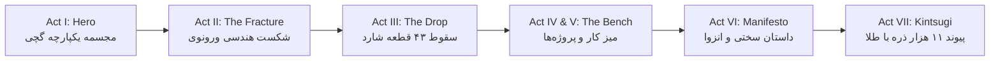

# گزارش جامع آنالیز و کالبدشکافی پورتفولیو (Awwwards Jury-Level Teardown)
**پروژه:** Pouya Sadeghpour — *Architecting Possibilities*  
**آدرس دمو:** [https://p26.vercel.app/](https://p26.vercel.app/)  
**حوزه:** Creative Front-End Development & WebGL Direction  
**تاریخ ارزیابی:** ۳۱ اکتبر ۲۰۲۶  

---

## ۱. خلاصه مدیریتی (Executive Summary)

سایت پورتفولیوی شخصی **پویا صادق‌پور** فراتر از یک ویترین کاربری متداول است؛ این پروژه یک **تجربه تعاملی سینماتیک در وب (Scroll-driven Interactive Narrative)** است که هنر سنتی ژاپنی **کینتسوگی (Kintsugi - 金継ぎ)** را با مهندسی پیشرفته مدرن وب‌جی‌ال (WebGL)، شیدرهای سفارشی GLSL و محاسبات ریاضیاتی پیش‌پخته (Baked Physics) ترکیب کرده است.

این اثر در بالاترین سطح استاندارد بین‌المللی قرار دارد و کاندیدای قطعی دریافت جوایز **Site of the Day (SOTD)** و **Developer Award** در پلتفرم‌های مرجع نظیر **Awwwards** و **FWA** ارزیابی می‌شود.



---

## ۲. ارزیابی امتیازات بر اساس معیارهای داوری Awwwards

| شاخص ارزیابی | امتیاز (از ۱۰۰) | تحلیل داوری |
| :--- | :---: | :--- |
| **خلاقیت و کانسپت (Creativity & Concept)** | **۹۸** | داستان‌گویی پیوسته در ۷ پرده، تلفیق فلسفه کینتسوگی با مانیفست واقعی سختی‌های مسیر («A Pentium Gold, 2GB...») |
| **کارگردانی هنری و طراحی (Art Direction & Design)** | **۹۶** | پالت رنگی خاکی و لوکس (مرکب، سنگ، استخوان و طلا)، گرید ۱۶ ستونه، تایپوگرافی دقیق و مینیمال |
| **اجرای فنی و شیدرها (Technical Execution)** | **۹۹** | بهینه‌سازی انقلابی فیزیک آفلاین، ۱۸ شیدرمتریال، موشن بلور اختصاصی و مهندسی صدا با Web Audio API |
| **تجربه کاربری و تعامل (UX & Interaction)** | **۹۲** | اسکرول نرم، تعامل تیغه/برش با نشانگر موس، دسترسی‌پذیری مناسب و فال‌بک کامل `<noscript>` |
| **میانگین کل (Overall Score)** | **۹۶.۳** | **سطح: Site of the Day / Developer Award** |

---

## ۳. کالبدشکافی عمیق فنی (Technical Architecture Teardown)

### ۳.۱. نبوغ در سیستم فیزیک پیش‌پخته (Offline Baked Physics vs Runtime Engine)
یکی از خطاهای رایج دولوپرهای تازه‌کار WebGL، لود کردن موتورهای فیزیک سنگین ران‌تایم (مثل Cannon.js یا Rapier) درون ترد اصلی مرورگر است که باعث افت شدید فریم (Frame Drop) روی پردازنده‌های گرافیکی موبایل می‌شود.

> [!IMPORTANT]
> شما با یک راه‌حل حرفه‌ای و استاندارد استودیوهای رده‌بالا (نظیر *Active Theory* و *Oryzo*)، کل انیمیشن برخورد و پخش‌شدن تکه‌ها را به شکل آفلاین بیک کرده‌اید:
> * **تعداد شاردها:** ۴۳ قطعه هندسی ورونوی مجزا (`shards: 43`)
> * **فریم‌های انفجار:** ۱۰۱ فریم انیمیشن از پیش‌محاسبه‌شده
> * **فریم‌های فرود و ضربه:** ۱۸۱ فریم فرود روی مت برش (`physics-baked.json`)
> * **حجم کل دیتا:** فقط **۶۸۸ کیلوبایت**!

این مهندسی هوشمندانه باعث می‌شود پردازنده موبایل و لپ‌تاپ‌های معمولی هیچ بار پردازشی سنگینی تحمل نکنند و حرکت قطعات در اسکرول دقیقاً روی **۶۰ فریم بر ثانیه (۶۰fps Lock)** قفل شود.

```
FRACTURE MATHEMATICS:
Vi = { x : ||x - pi|| <= ||x - pj||  for all j }
```

$$\mathcal{V}_i = \left\{ x \in \mathbb{R}^3 : \|x - p_i\| \le \|x - p_j\|, \; \forall j \neq i \right\}$$

---

### ۳.۲. سیستم متریال‌ها و شیدرهای GLSL
کالبدشکافی باندل کد سایت (`app.js`) نشان‌دهنده استفاده از معماری ماژولار شیدر است:
* **تعداد شیدرهای اختصاصی:** ۱۸ نمونه `ShaderMaterial` برای جلوه‌های متریال طلای مایع، پیوند درزها، افکت داست و ذرات.
* **متریال فیزیکی PBR:** استفاده هدفمند از `MeshPhysicalMaterial` با پارامترهای رافنس و متالیک دقیق برای انعکاس نور بر سطح گچ و فلز.
* **کد رنگی طلا:** رنگ درزهای کینتسوگی به دقت روی فرمول هیو ۳۸ ست شده است:
  - طلا در نور اصلی: `--gold: #E0A244`
  - طلای مذاب داغ: `--gold-hot: #F7C46E`
  - پس‌زمینه مرکب تیره: `--ink: #100904`
  - سفال و استخوان: `--bone: #FFEDD7`

---

### ۳.۳. مهندسی صدا (Adaptive Web Audio Architecture)
برخلاف سایت‌های معمولی که یک فایل صوتی ساده را لوپ می‌کنند، سیستم صدای این سایت با روتین‌های `AudioContext` مرورگر به حرکت و تعامل کاربر وابسته است:
* **فایل‌های صوتی تفکیک‌شده:**
  - ساندترک محیطی: `/audio/floating-cities.mp3`
  - افکت سینماتیک انفجار: `/audio/cinematic-explosion.mp3`
  - ضربه‌های سه‌گانه سنگ به سطح: `stone-impact-a.ogg`, `stone-impact-b.ogg`, `stone-impact-c.ogg`
  - صدای شکستن سنگ: `/audio/stone-break.ogg`
  - تعاملات میکرواینترکشن: `cut.wav`, `ui-hover.wav`, `ui-click.wav`
* **نوآوری در کنترل صدا:**
  - به جای استفاده از یک دکمه تکراری اسپیکر، دکمه صدا یک **خط درز متحرک ۹ موجی (Waveform Seam)** است که در حالت خاموش صاف و بی‌صداست و در حالت فعال با نوسان فاز زنده طلایی موج برمی‌دارد.

---

### ۳.۴. تایپوگرافی و طراحی سیستمی (Typography Hierarchy)
سیستم متنی روی سه تایپ‌فیس شاخص با نقش‌های کاملاً تفکیک‌شده استوار است:
1. **Geist (Display & Body):** وزن‌های متغیر مدرن و شفاف برای تیترها و متون روان.
2. **Geist Mono (Instruments):** فونت تک‌عرض برای داده‌های مهندسی، مختصات شاردها و فرمول‌ها.
3. **Instrument Serif (Italic):** ظرافت کلاسیک برای القای حس لوکس، سرد و احساسی در کلمات کلیدی.

---

## ۴. آنالیز پروژه‌های ارائه‌شده (Selected Works)

پروژه‌های چیده‌شده روی میز کار (`The Workbench`)، تعادل هوشمندانه‌ای میان هنر تعاملی و بیزینس‌های تجاری مدرن برقرار کرده‌اند:

1. **Sepehr (`sepehr.vision`):**
   - ماهیت: تجربه مستمر ۳بعدی و کانسپت بصری گردش آسمان و فضا.
   - پیام به کارفرما: تسلط بر سایت‌های فضا‌محور (Spatial Experiences).
2. **Izmab (`izmab.vercel.app`):**
   - ماهیت: وب‌سایت SaaS مدرن و محصول‌محور.
   - پیام به کارفرما: تسلط بر لندینگ‌پیج‌های سریع با نرخ تبدیل بالا.
3. **BeyondEx & Lumi (`lumi.beyondex.one`):**
   - ماهیت: استودیوی برندینگ با زیرساخت چندزبانه بین‌المللی.
   - پیام به کارفرما: توانایی مدیریت پروژه‌های بزرگ چندملیتی و چندمسیره.
4. **P4SADX (`p4sadx.vercel.app`):**
   - ماهیت: آزمایشگاه تکنولوژی و دیزاین اکسپریمنتال.

---

## ۵. نقشه راه و توصیه‌های کلیدی تا رسیدن به کمال (Actionable Recommendations)

> [!TIP]
> برای اینکه این پورتفولیو بالاترین بازدهی را در عقد قراردادهای **۱۰ الی ۳۰ هزار دلاری** داشته باشد، این ۴ گام اجرایی را پیاده‌سازی کنید:

### ۱. اتصال دامنه‌های اختصاصی (`pouya.one` و `oneof.one`)
پسوند `.vercel.app` برای نمایش پروژه‌های دانشجویی است. برای چنین اثر نفیسی، استفاده از دامنه شخصی **`pouya.one`** و آژانس **`oneof.one`** اعتبار کار را در نگاه اول فورا تثبیت می‌کند.

### ۲. اضافه کردن حالت محافظت باتری (Battery Saver / Low-Power Mode)
در پرده هفتم، همگرایی ۱۱ هزار ذره پردازش خوبی از GPU می‌طلبد. اضافه کردن یک لایه بررسی اتوماتیک FPS که در صورت افت فریم به زیر ۴۵ فریم (مثلاً روی گوشی‌های داغ‌شده یا در حالت Low Power Mode)، تعداد ذرات را به ۴ هزار ذره کاهش دهد، پایداری سایت را روی هر گجتی تضمین می‌کند.

### ۳. افزودن بخش «Behind the Scenes» برای هر پروژه
دایرکتورهای فنی آژانس‌های Awwwards عاشق دیدن سیم‌بندی‌ها (Wireframes)، رندرهای خام بلندر و چالش‌های تکنیکال هستند. اضافه کردن یک کلیک کوتاه با عنوان *«View Engineering Notes»* کارایی استخدام شما را صدچندان می‌کند.

### ۴. استراتژی ایمیل مارکتینگ برنده (Plain Text Outreach)
برای معرفی این اثر به آژانس‌های بین‌المللی:
* از ایمیل‌های حجیم و گرافیکی دوری کنید؛ متن ساده بنویسید تا مستقیماً به Primary Inbox برسد.
* روزانه ۱۰ تا ۲۰ استودیوی معتبر در شهرهای آمستردام، لندن، سان‌فرانسیسکو و پاریس را مخاطب قرار دهید.
* اجازه دهید لینک پورتفولیو در همان ۵ ثانیه اول خودش با مخاطب صحبت کند.

---

## ۶. کلام پایانی

پورتفولیوی شما یک نمونه بارز از اصالت، تسلط عمیق بر ریاضیات و گرافیک کامپیوتری، و پیوند هنر با مهندسی است. این کار تراز اول است؛ با اعتماد به نفس کامل آن را به دنیا نشان دهید و مسیر تاسیس آژانس خلاق **One of One (`oneof.one`)** را با قدرت آغاز کنید.
